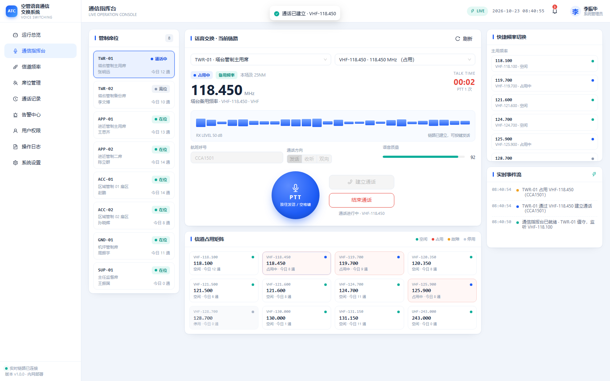
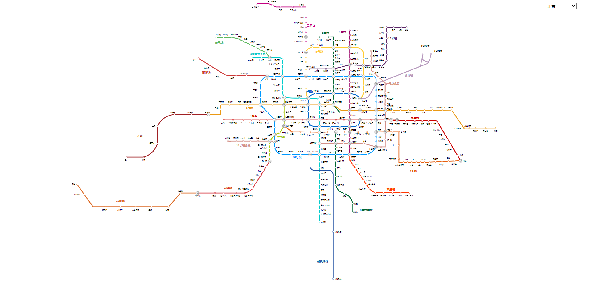
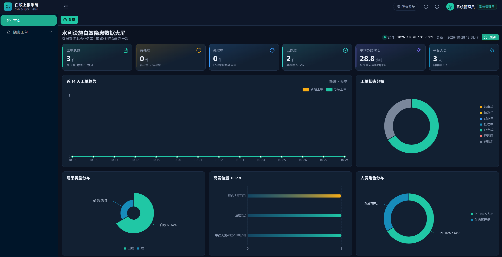
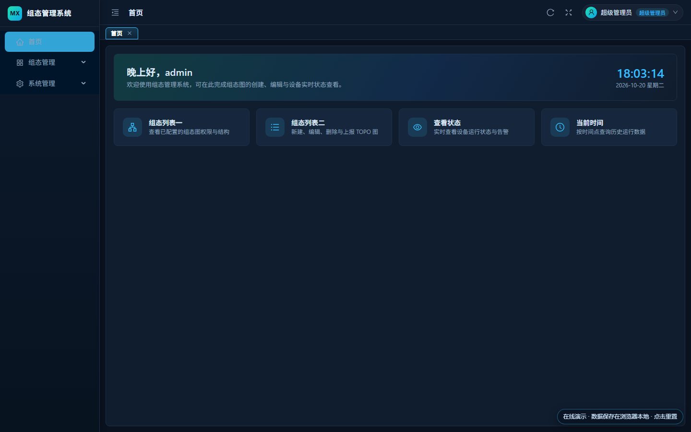
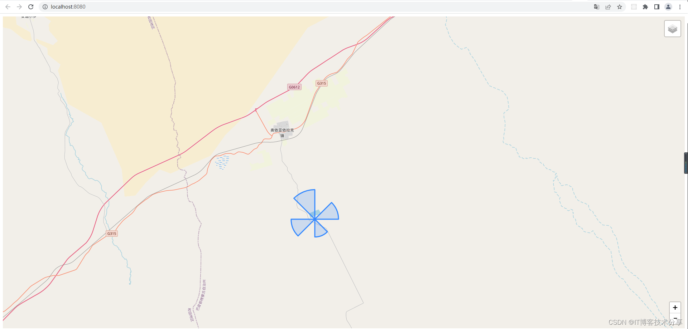
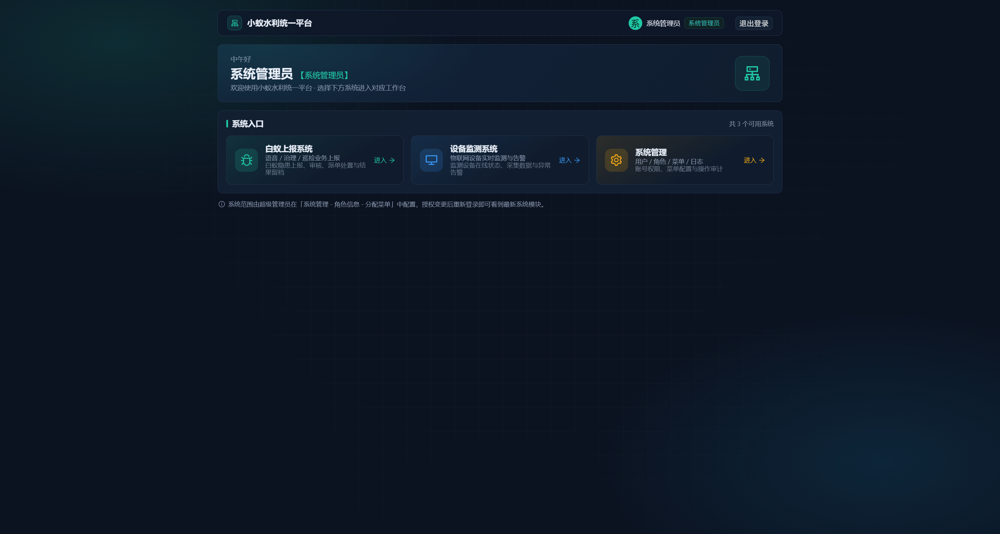

# nyy-2017 · 前端作品集

在线主页：<https://nyy-2017.github.io/>  
项目索引：<https://nyy-2017.github.io/index1.html>

首页 `index.html` 从 69 个开源仓库里精选了 **10 个项目**，下面是每个项目的演示图与在线地址 / 仓库地址，以及仓库内本地文件夹中的项目截图。

---

## 一、首页精选项目（10 个）

### 01 · 空管语音通信交换系统 ATC-VCS



- **技术栈**：Vue 3 · Vite · Pinia · ECharts · Express · SQLite
- **说明**：面向塔台 / 进近 / 区域管制的语音交换演示系统，需本地运行
- **仓库**：<https://github.com/nyy-2017/atc-vcs>

### 02 · 全国地铁线路图



- **技术栈**：原生 JS · SVG · jQuery · svg-pan-zoom
- **在线 Demo**：<https://nyy-2017.github.io/china_Subway/>

### 03 · 小蚁水利统一平台



- **技术栈**：Vue 3 · Ant Design Vue · ECharts · 微信小程序 · Node.js · SQLite
- **说明**：白蚁隐患上报一体化平台（PC 后台 + 小程序 + Node 服务），本地数据库优化版
- **仓库**：<https://github.com/nyy-2017/water_ant_report_optimized_local_db>

### 04 · 3D 立体照片墙


- **技术栈**：纯 CSS · 3D Transform · 关键帧动画
- **在线 Demo**：<https://nyy-2017.github.io/3d-cubic-images-master/>

### 05 · MX Graph 组态编辑器



- **技术栈**：Vue 3 · Vite · mxGraph · Ant Design Vue
- **仓库**：<https://github.com/nyy-2017/vue3_mxGraph-admin>

### 06 · 地图扇形覆盖绘制



- **技术栈**：Vue 2 · Leaflet.js · OpenStreetMap
- **仓库**：<https://github.com/nyy-2017/vue2-leaflet-semicircle>

### 07 · 图片海报生成器


- **技术栈**：Vue 2 · html2canvas · 移动端适配
- **在线 Demo**：<https://nyy-2017.github.io/upload-avatar/>

### 08 · 微信小程序案例库

- **技术栈**：微信小程序 · 120+ 个源码合集（首页为 CSS 示意图，暂无截图）
- **仓库**：<https://github.com/nyy-2017/wechat-app-demos>

### 09 · HTML5 拓扑图编辑器

- **技术栈**：SVG · jQuery（首页为 CSS 示意图，暂无截图）
- **仓库**：<https://github.com/nyy-2017/vue_topo>

### 10 · 大文件分片上传

- **技术栈**：Web Worker · 分片上传 · 线程池（首页为 CSS 示意图，暂无截图）
- **仓库**：<https://github.com/nyy-2017/file-web-worker>

---

## 二、本地文件夹项目截图

### 空管语音通信交换系统 ATC-VCS · 8 张界面截图

> 路径：`空管语音通信交换系统 ATC-VCS 项目截图/`

| 登录页 | 数据大屏 |
| :---: | :---: |
|  |  |
| **通信指挥台** | **信道管理** |
|  |  |
| **席位管理** | **通话记录** |
|  |  |
| **告警中心** | **系统设置** |
|  |  |

### 3D 立体照片墙 · 六个面

> 路径：`3d-cubic-images-master/img/`

| front | right | left |
| :---: | :---: | :---: |
|  |  |  |
| **top** | **lower** | **after** |
|  |  |  |

### 图片海报生成器 · 模板素材

> 路径：`upload-avatar/static/img/`

| 背景 | 模板 1 | 模板 2 | 模板 3 |
| :---: | :---: | :---: | :---: |
|  |  |  |  |

### 小蚁水利统一平台 · 界面截图

> 路径：`img/`

| 首页 / 数据大屏 | 工单 / 详情 |
| :---: | :---: |
|  |  |

### 其他素材

> 路径：`other-img/`


---

## 目录结构

```text
.
├── index.html                   # 作品集入口（精选 10 个项目）
├── index1.html                  # 项目索引页
├── img/                         # 入口文件用到的项目封面 / 演示图
├── other-img/                   # 其他素材
├── china_Subway/                # 全国地铁线路图（本地可运行）
├── 3d-cubic-images-master/      # 3D 立体照片墙（本地可运行）
├── upload-avatar/               # 图片海报生成器（本地可运行）
└── 空管语音通信交换系统 ATC-VCS 项目截图/   # ATC-VCS 界面截图
```

## 部署

本项目通过 **GitHub Pages** 发布，仓库根目录即为站点根目录，推送 `main` 分支后自动生效。入口页为 `index.html`。
